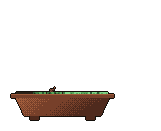

<picture>
  
</picture>
<a href="https://github.com/yalongwastaken#year-list-container">
  <picture>
    <source media="(prefers-color-scheme: dark)" srcset="https://github-readme-stats.vercel.app/api?username=yalongwastaken&amp;hide_border=true&amp;disable_animations=true&amp;bg_color=00000000&amp;title_color=c2cd86&amp;text_color=c9d1d9&amp;icon_color=56d364&amp;card_width=400&amp;show_icons=true&amp;rank_icon=github&amp;ring_color=c2cd86">
    
  </picture>
</a>
 
<a href="https://github.com/yalongwastaken?tab=repositories">
  <picture>
    <source media="(prefers-color-scheme: dark)" srcset="https://github-readme-stats.vercel.app/api/top-langs/?username=yalongwastaken&amp;hide_border=true&amp;disable_animations=true&amp;bg_color=00000000&amp;title_color=c2cd86&amp;text_color=c9d1d9&amp;icon_color=56d364&amp;card_width=400&amp;layout=compact&amp;size_weight=0&amp;count_weight=1&amp;langs_count=6&amp;hide=html%2Ccss%2Cmakefile%2Ccmake%2Cjupyter+notebook%2Ctex%2Cshell%2Cdockerfile&amp;custom_title=Languages+by+repo+count">
    
  </picture>
</a>
 
